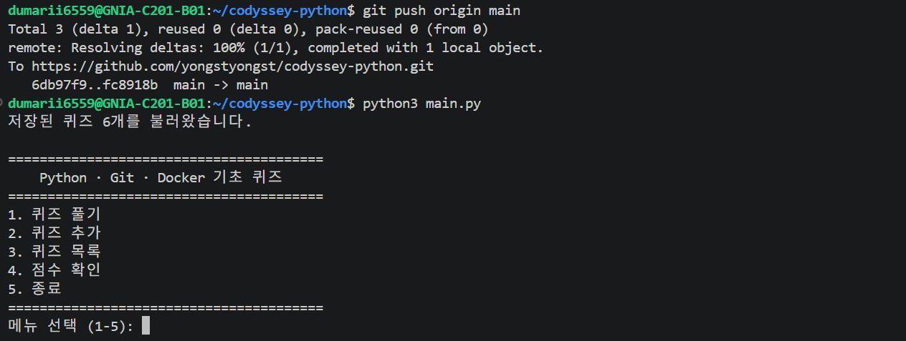
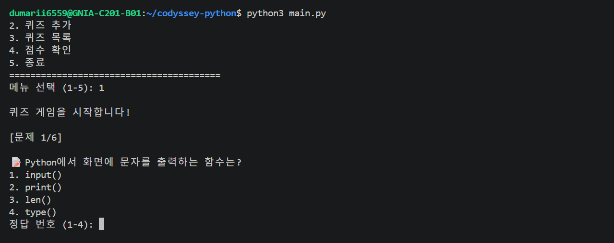
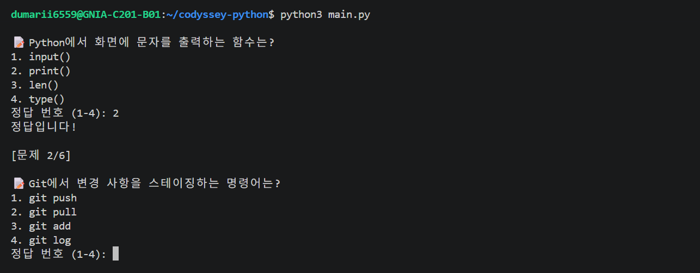
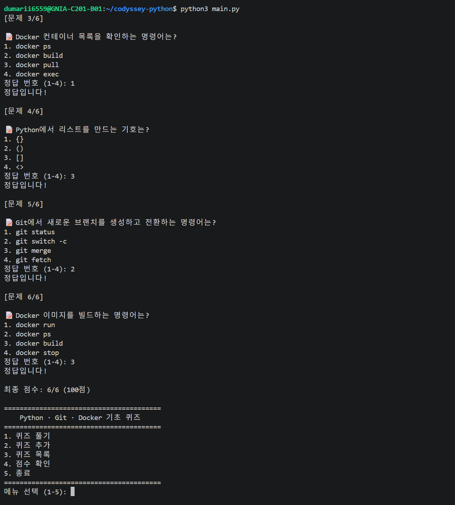
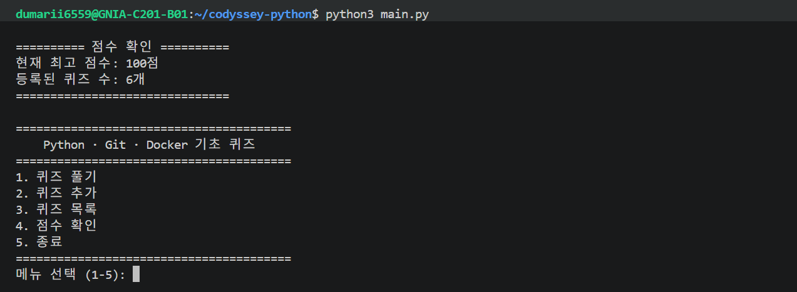
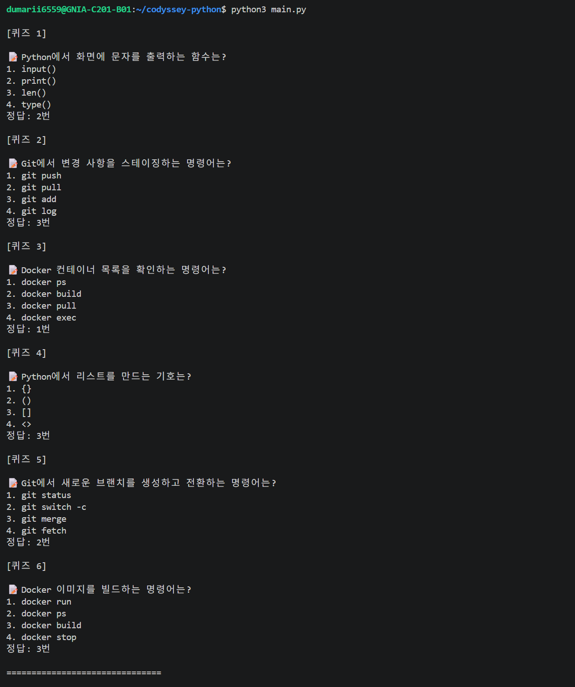
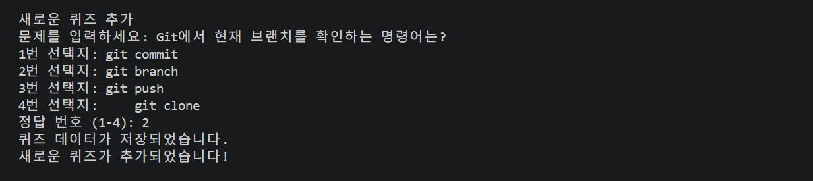
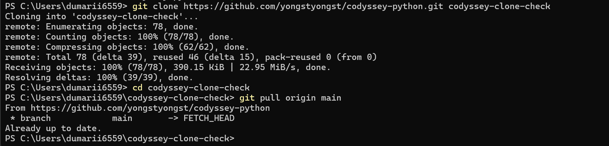
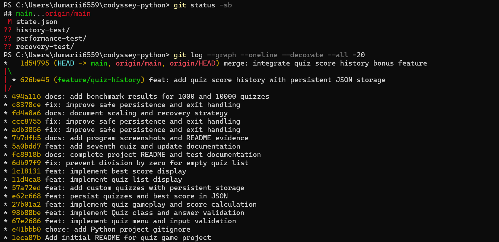

# Python · Git · Docker 기초 퀴즈 게임

**Codyssey 개발 입문 — Python 프로그래밍 미션**

<br>

## 1. 프로젝트 소개

본 프로젝트는 코디세이 교육 과정에서 학습한 Python, Git, Docker의 핵심 개념을 복습하기 위해 제작한 터미널 기반 4지선다형 퀴즈 게임입니다.

Python의 조건문, 반복문, 함수, 클래스, 파일 입출력 및 예외 처리를 활용하여 실제로 동작하는 프로그램을 완성하는 것을 목표로 하였습니다.

단순히 정해진 문제를 푸는 것에 그치지 않고, 사용자가 새로운 문제를 등록하고 학습 결과를 저장할 수 있도록 구현하였습니다.

### 개발 목표

- Python 기초 문법을 실제 프로그램에 적용
- 객체지향 프로그래밍을 활용한 기능 분리
- JSON 파일을 이용한 데이터 저장 및 불러오기
- 사용자 입력 검증과 예외 처리 구현
- Git과 GitHub를 이용한 단계별 개발 이력 관리

<br>

## 2. 퀴즈 주제 선정 이유

코디세이 교육 과정에서 CLI, Git, Docker를 학습하면서 개념과 명령어를 반복적으로 복습할 필요성을 느꼈습니다.

이에 학습 내용을 직접 퀴즈로 만들어 풀 수 있는 프로그램을 개발하고자 하였습니다.

Python으로 프로그램을 구현하는 동시에 Git과 Docker 관련 지식도 복습할 수 있다는 점에서 교육 과정과 연계성이 높다고 판단하였습니다.

또한 새로운 문제를 사용자가 직접 추가하도록 구성하여 향후 다양한 학습 주제로 확장할 수 있도록 하였습니다.

<br>

## 3. 개발 환경

| 항목 | 사용 환경 |
|---|---|
| 프로그래밍 언어 | Python 3.14.4 |
| 운영 환경 | Ubuntu / WSL2 |
| 개발 도구 | Visual Studio Code |
| 버전 관리 | Git |
| 원격 저장소 | GitHub |
| 데이터 저장 | JSON |
| 실행 방식 | 터미널 기반 CLI |

<br>

## 4. 프로젝트 파일 구조

```text
codyssey-python/
├── main.py
├── quiz.py
├── quiz_game.py
├── state.json
├── hello.py
├── .gitignore
├── README.md
└── state.json.bak  # 실행 후 자동 생성되는 백업(로컬 보관)
```


### 파일별 역할

**main.py**

프로그램의 진입점으로 메뉴 출력, 사용자 입력 검증, 기능 호출 및 종료를 담당합니다.

**quiz.py**

`Quiz` 클래스를 정의한 파일입니다. 문제와 선택지, 정답을 관리하고 문제 출력 및 정답 확인 기능을 제공합니다.

**quiz_game.py**

`QuizGame` 클래스를 정의한 파일입니다. 퀴즈 진행, 문제 등록, 목록 조회, 점수 계산, JSON 데이터 저장과 불러오기를 담당합니다.

**state.json**

등록된 퀴즈 목록과 최고 점수를 저장합니다.

**hello.py**

개발 초기 Python 실행 환경을 확인하기 위한 실습 파일입니다.

**.gitignore**

Git에서 추적하지 않을 파일이나 폴더를 지정합니다.

<br>

## 5. 프로그램 실행 방법

저장소를 복제합니다.

```bash
git clone https://github.com/yongstyongst/codyssey-python.git
```

프로젝트 폴더로 이동합니다.

```bash
cd codyssey-python
```

프로그램을 실행합니다.

```bash
python3 main.py
```

프로그램 실행 시 다음 메뉴가 표시됩니다.

```text
========================================
    Python · Git · Docker 기초 퀴즈
========================================
1. 퀴즈 풀기
2. 퀴즈 추가
3. 퀴즈 목록
4. 점수 확인
5. 종료
========================================
메뉴 선택 (1-5):
```

사용자는 메뉴 번호를 입력하여 원하는 기능을 실행할 수 있습니다.

<br>

## 6. 주요 구현 기능


### 6.1 퀴즈 풀기

등록된 퀴즈를 순서대로 출력하며, 사용자는 1~4번 중 정답을 선택합니다.

정답 여부를 즉시 확인할 수 있으며 전체 문제를 완료하면 점수를 계산합니다.

점수 계산 방식은 다음과 같습니다.

**최종 점수 = 정답 개수 / 전체 문제 수 × 100**

계산 결과에 `round()`를 적용하여 정수 점수로 표시합니다.

기존 최고 점수를 초과하면 새로운 최고 점수를 JSON 파일에 저장합니다.

### 6.2 퀴즈 추가

사용자가 직접 문제와 선택지 4개, 정답 번호를 입력하여 새로운 퀴즈를 등록할 수 있습니다.

문제 내용이나 선택지를 비워둘 수 없으며, 정답 번호는 1~4로 제한합니다.

새로운 문제를 추가하면 `state.json` 파일에 저장되어 프로그램을 재실행해도 유지됩니다.

### 6.3 퀴즈 목록 조회

등록된 전체 퀴즈의 문제, 선택지, 정답을 확인할 수 있습니다.

퀴즈가 없는 경우에는 별도의 안내 메시지를 출력합니다.

### 6.4 최고 점수 확인

현재까지 기록된 최고 점수와 등록된 전체 퀴즈 수를 출력합니다.

### 6.5 입력값 검증

메뉴에서 빈 입력, 숫자가 아닌 입력, 범위를 벗어난 번호를 처리합니다.

퀴즈 정답 입력 또한 1~4번으로 제한하며, 유효하지 않은 값을 입력하면 재입력을 요청합니다.

<br>

## 7. 객체지향 프로그래밍 적용

프로그램을 하나의 파일에 모두 작성하지 않고 기능별로 분리하였습니다.

### Quiz 클래스

개별 문제의 데이터와 동작을 관리합니다.

주요 메서드는 다음과 같습니다.

- `__init__()` : 문제 데이터 초기화 및 기본 검증
- `display()` : 문제와 선택지 출력
- `check_answer()` : 정답 여부 판별

### QuizGame 클래스

여러 개의 퀴즈를 관리하고 게임 전체 흐름을 담당합니다.

주요 메서드는 다음과 같습니다.

- `load_state()` : 저장 데이터 불러오기
- `save_state()` : JSON 데이터 저장
- `play()` : 퀴즈 게임 진행
- `add_quiz()` : 새로운 퀴즈 등록
- `list_quizzes()` : 퀴즈 목록 조회
- `show_score()` : 최고 점수 확인

이러한 구조를 통해 메뉴 처리, 개별 문제 관리, 게임 운영을 구분하여 코드의 역할을 명확하게 하였습니다.

<br>

## 8. JSON 데이터 영속성


프로그램 종료 후에도 등록된 퀴즈와 최고 점수가 유지되도록 JSON 파일을 사용하였습니다.

데이터는 다음과 같은 구조로 저장됩니다.

```json
{
  "quizzes": [
    {
      "question": "Python에서 화면에 문자를 출력하는 함수는?",
      "choices": [
        "input()",
        "print()",
        "len()",
        "type()"
      ],
      "answer": 2
    }
  ],
  "best_score": 100
}
```

위 내용은 데이터 구조를 설명하기 위한 예시입니다.

프로그램 시작 시 `load_state()`를 호출하여 저장된 데이터를 읽습니다.

문제 추가 또는 최고 점수 갱신 시 `save_state()`를 호출하여 변경 사항을 기록합니다.

문자열의 한글이 정상적으로 저장되도록 UTF-8 인코딩과 `ensure_ascii=False` 옵션을 사용하였습니다.

<br>

## 9. 예외 처리 및 트러블슈팅

### 9.1 잘못된 메뉴 입력

**문제**

사용자가 숫자가 아닌 문자 또는 허용 범위 밖의 번호를 입력할 수 있습니다.

**해결**

`strip()`, `int()`, `try-except` 및 조건문을 사용하여 입력값을 검증하고, 잘못된 입력에 대해 안내 메시지를 출력하도록 구현하였습니다.

**검증**

빈 입력, 문자 입력 및 범위를 벗어난 번호에 대한 처리를 확인하였습니다.

### 9.2 빈 퀴즈 목록에서 점수 계산 오류

**문제**

등록된 퀴즈가 없는 상태에서 점수를 계산하면 0으로 나누는 오류가 발생할 수 있습니다.

**원인**

전체 문제 수를 분모로 사용하는 점수 계산 방식 때문입니다.

**해결**

`play()` 메서드에서 전체 문제 수가 0인지 먼저 검사하고, 문제가 없는 경우 안내 메시지를 출력한 후 반환하도록 수정하였습니다.

**검증**

퀴즈 목록을 메모리에서 일시적으로 비운 상태로 실행하여 오류 없이 종료되는 것을 확인하였습니다.

### 9.3 손상된 JSON 파일

**문제**

JSON 파일의 형식이 잘못되면 저장 데이터를 정상적으로 읽을 수 없습니다.

**해결**

`load_state()`에서 파일 읽기 및 데이터 검증 과정의 주요 예외를 처리하고, 오류 메시지 출력 후 초기 상태를 유지하도록 구성하였습니다.

**검증**

별도의 임시 폴더에 문법이 잘못된 JSON 파일을 만들어 테스트하였습니다.

프로그램이 비정상 종료되지 않았으며 빈 퀴즈 목록과 기본 점수로 처리되는 것을 확인하였습니다.

이제 시작할 때 원본 데이터가 손상되었으면 검증된 `state.json.bak`으로 복원합니다. 원본과 백업이 모두 손상된 경우 기존 파일 보호를 위해 저장을 잠급니다.

### 9.4 프로그램 실행 중 입력 중단

**문제**

사용자가 입력 도중 `Ctrl+C` 또는 `Ctrl+D`를 사용할 수 있습니다.

**해결**

`main.py`에서 `KeyboardInterrupt`와 `EOFError` 예외를 처리하여 안내 메시지를 출력한 후 종료하도록 구현하였습니다.

**검증**

퀴즈 정답 입력 중 `Ctrl+C`, 메인 메뉴에서 `Ctrl+D`를 사용하여 안전하게 종료되는 것을 확인하였습니다.

<br>

## 10. Git 및 GitHub 활용


기능 단위로 변경 사항을 기록하기 위해 Git을 사용하였습니다.

주요 작업은 다음과 같습니다.

- Git 저장소 초기화
- 파일 추가 및 기능별 커밋
- 기능 개발용 브랜치 생성
- `feature/quiz-play` 브랜치 작업
- `main` 브랜치 병합
- GitHub 원격 저장소에 Push
- 별도의 폴더에서 Clone 실행
- Pull 명령을 이용한 동기화 확인

2026년 11월 8일 기준으로 총 11개의 커밋을 생성하였습니다.

예외 처리 보강에 대한 커밋은 다음과 같습니다.

```text
6db97f9 fix: prevent division by zero for empty quiz list
```

별도 테스트 폴더에 저장소를 복제하여 최신 커밋이 정상적으로 포함된 것을 확인하였습니다.

또한 `git pull origin main` 명령 실행 시 `Already up to date.`가 출력되어 로컬과 원격 저장소가 동기화되어 있음을 확인하였습니다.

<br>

## 11. 기능 테스트 결과

| 테스트 항목 | 결과 |
|---|---|
| 메뉴 표시 및 선택 | 통과 |
| 잘못된 메뉴 입력 | 통과 |
| 퀴즈 문제 출력 | 통과 |
| 정답 및 오답 판별 | 통과 |
| 점수 계산 | 통과 |
| 사용자 문제 추가 | 통과 |
| 문제 목록 조회 | 통과 |
| JSON 저장 및 재실행 | 통과 |
| 최고 점수 유지 | 통과 |
| 빈 문제 목록 처리 | 통과 |
| 손상된 JSON 파일 처리 | 통과 |
| Ctrl+C 종료 | 통과 |
| 메인 메뉴 Ctrl+D 종료 | 통과 |
| Git Clone | 통과 |
| Git Pull | 통과 |

초기 기능 검증 당시 등록된 문제는 6개였으며, 이후 사용자 퀴즈 추가 기능을 검증하여 총 7개로 확장하였습니다. 최고 점수는 100점으로 유지되었습니다.

<br>

## 12. 실행 화면 및 증빙

### 12.1 메인 메뉴


### 12.2 퀴즈 실행


### 12.3 정답 판별


### 12.4 최종 점수


### 12.5 최고 점수 확인


### 12.6 퀴즈 목록


### 12.7 새로운 퀴즈 추가


<br>

## 13. 회고 및 개선 방향

이번 프로젝트를 통해 Python 문법을 학습하는 것과 실제 프로그램을 완성하는 과정에는 차이가 있다는 점을 경험하였습니다.

특히 객체지향 설계를 적용하여 코드의 책임을 분리하고, JSON을 통해 데이터를 유지하며, 예외 상황을 직접 재현하고 수정하는 과정이 의미 있었습니다.

Git을 활용하여 기능별 변경 사항을 기록하고, 별도의 브랜치에서 개발한 내용을 병합하면서 버전 관리의 필요성도 이해할 수 있었습니다.

향후에는 JSON 데이터 검증 강화, 저장 실패 처리 개선, 문제 무작위 출제, 문제별 해설 기능 등을 추가하여 프로그램의 완성도를 높이고자 합니다.

<br>

## 14. AI 사전평가 보완: 종료 시 저장 (#11)

`main.py`의 `main()`은 `try/finally` 구조로 종료합니다. 메뉴 5번, Ctrl+C, Ctrl+D 등 프로그램의 정상적인 종료 경로에서 `finally`를 거쳐 `game.save_state()`를 호출합니다. 저장 실패는 오류 메시지로 알립니다. 강제 프로세스 종료(SIGKILL)나 정전 시 종료 루틴의 실행은 보장할 수 없으므로, 문제 추가 및 최고 점수 갱신 시에도 즉시 저장합니다.

<br>

## 15. JSON 백업 및 복원 전략 (#17)

- **저장:** `save_state()`가 현재 데이터를 같은 폴더의 임시 파일에 UTF-8 JSON으로 기록하고 디스크에 동기화합니다. 검증된 새 데이터로 `state.json.bak`을 원자적으로 교체한 다음 `state.json`을 교체합니다. 임시 파일은 정리합니다.
- **불러오기:** `load_state()`가 우선 `state.json`의 JSON 구조, 정답 범위, 최고 점수 형식 등을 검사합니다.
- **복원:** 원본이 없거나 손상되면 백업 파일의 구조를 검증한 뒤 원본에 복사해 복원합니다.
- **복구 실패:** 원본과 백업 모두 사용할 수 없는 경우 `_load_failed` 플래그로 저장을 차단해 손상된 파일을 빈 값으로 덮어쓰지 않습니다.
- **수동 복구:** 프로그램을 종료하고 두 파일을 다른 위치에 복사해 보관합니다. 백업의 JSON이 올바른지 확인한 후 `cp state.json.bak state.json`으로 복원하여 재실행합니다. 손상된 원본이나 백업을 확인 없이 삭제하지 마세요.
- **한계:** 백업은 같은 장치에 있는 최신 저장본이며 세대별 이력 백업이 아닙니다. 동일 장치 장애나 사용자의 실수로 인한 논리적 데이터 변경까지 보호하지는 못합니다. Git 또는 별도 저장매체 백업을 권장합니다.

<br>

## 16. 1,000개 이상 문제에 대한 성능 및 확장성 분석 (#16)

현재 프로그램은 모든 문제를 메모리의 Python 리스트에 적재하는 방식입니다. 퀴즈 개수를 `n`, 전체 직렬화 데이터 크기를 `S` 바이트로 정의합니다.

| 동작 | 현재 방식 | 시간 복잡도 | 보완 방향 |
|---|---|---|---|
| 시작 시 데이터 읽기 | JSON 전체 파싱 후 리스트 생성 | O(S) | 문제 수 증가 시 SQLite 등으로 필요한 문제만 조회 |
| 새 문제 추가 | 리스트 `append` | 평균 O(1), 저장 포함 O(S) | 데이터베이스 INSERT로 전체 재기록 감소 |
| 순차 풀이 | 모든 문제 순회 | O(n) | 출제 개수 제한·페이지 단위 조회 |
| 목록 출력 | 전체 문제 출력 | O(n) | 20~50개 단위 페이징 |
| 제목·키워드 검색(향후) | 리스트 선형 탐색 | O(n) | 검색용 인덱스 또는 SQLite 인덱스 |
| JSON 저장·백업 | 모든 문제 직렬화 및 파일 2개 기록 | O(S) | 변경 데이터만 저장하는 DB 사용 |

메모리 사용량은 로드한 문항·선택지 문자열 등 객체 크기에 비례해 **O(S)** 규모로 증가합니다. 실제 메모리 소비량에는 Python 객체 오버헤드가 포함됩니다. 예를 들어 1,000개 문제에 선택지 4개가 있으면 문제와 선택지를 합쳐 최소 5,000개의 문자열이 관리됩니다. 파일 크기만으로 정확한 메모리 사용량을 계산할 수 없으므로 여기서는 실측 수치를 주장하지 않습니다.

**대규모 데이터 확장 계획:**
1. 문제 1,000개 / 10,000개를 생성한 테스트 데이터로 로드 시간, 저장 시간, 최대 메모리를 측정합니다(향후 수행할 성능 시험).
2. 모든 문항을 한 번에 출력하지 않고 20개씩 페이징합니다.
3. 문제 검색이 요구될 경우 제목·분류 필드를 추가하고 인덱싱합니다.
4. 문제 수가 더 증가하면 JSON 전체 재기록 대신 SQLite로 전환해 조회 및 부분 수정 비용을 절감합니다.

위 항목은 **현재 구현 방식에 대한 이론적 분석과 향후 개선 설계**이며, 1,000개 이상 데이터의 실측 완료 또는 페이징·SQLite 기능 구현을 의미하지 않습니다.

<br>

## 17. 대량 데이터 성능 테스트 결과

Python 3.14.10과 Docker 환경에서 퀴즈 1,000개 및 10,000개를 생성하여 JSON 저장과 불러오기 성능을 측정하였습니다.

| 측정 항목 | 1,000개 | 10,000개 |
|---|---:|---:|
| JSON 저장 시간 | 0.0377초 | 0.2860초 |
| JSON 불러오기 시간 | 0.0062초 | 0.0511초 |
| 최대 추적 메모리 | 1.04 MB | 9.19 MB |
| 복원된 문제 수 | 1,000개 | 10,000개 |

측정에는 `time.perf_counter()`와 `tracemalloc`을 사용하였습니다. 최대 추적 메모리는 Python 추적 할당량이며 전체 프로세스 메모리 사용량과는 다릅니다.

데이터가 10배 증가했을 때 저장 시간은 약 7.6배, 불러오기 시간은 약 8.2배 증가했습니다. 측정은 각 규모에서 1회 수행했으므로 반복 시험에 따른 평균 성능을 나타내지는 않습니다.

현재는 전체 데이터를 JSON으로 저장하고 불러오는 방식으로, 데이터 크기에 비례해 처리 비용이 증가합니다. 향후 문제 수가 증가하면 목록 페이징, 검색 인덱싱, SQLite 기반 부분 조회 및 수정 방식으로 개선할 계획입니다.

<br>

## 18. 보너스 과제 — 점수 기록 히스토리

### 18.1 구현 목적

기존 프로그램은 최고 점수만 저장하므로 이전 응시 결과를 확인하기 어려웠습니다.

이를 개선하기 위해 퀴즈를 완료할 때마다 학습 기록을 누적 저장하고, 메뉴에서 조회할 수 있도록 구현하였습니다.

### 18.2 주요 구현 기능

- 응시 날짜 및 시간 저장
- 푼 문제 수와 정답 수 기록
- 회차별 점수 기록
- 총 응시 횟수 및 최고 점수 표시
- JSON 파일을 이용한 기록 영속성 유지
- 기존 JSON 파일과의 호환성 유지
- 한국 시간대(Asia/Seoul) 적용

### 18.3 데이터 구조

기존 state.json에 history 배열을 추가하였습니다.

```json
{
  "history": [
    {
      "date": "2026-11-11 10:14:36",
      "total": 7,
      "correct": 6,
      "score": 86
    }
  ]
}
```

위 JSON은 학습 기록 부분만 발췌한 예시입니다. 실제 파일에는 quizzes와 best_score도 포함됩니다.

### 18.4 설계 및 구현

QuizGame 클래스에 history 리스트와 show_history() 메서드를 추가하였습니다.

퀴즈 완료 시 datetime을 이용해 응시 시간을 생성하고, 점수와 함께 history에 추가합니다.

기록은 save_state()를 통해 JSON 파일에 저장됩니다.

기존 데이터에 history 필드가 없는 경우에는 빈 리스트를 사용하도록 하여 이전 버전과의 호환성을 유지하였습니다.

### 18.5 테스트 결과

| 테스트 항목 | 결과 |
|---|---|
| 학습 기록이 없는 경우 안내 출력 | 통과 |
| 7문제 중 6개 정답, 86점 기록 | 통과 |
| 최고 점수 100점 유지 | 통과 |
| 응시 날짜와 시간 저장 | 통과 |
| 프로그램 종료 후 재실행 | 통과 |
| JSON 학습 기록 유지 | 통과 |
| Docker 환경에서 한국 시간대 확인 | 통과 |

### 18.6 개선 효과

기존에는 최고 점수만 확인할 수 있었지만, 히스토리 기능을 추가하여 학습자의 응시 과정과 점수 변화를 확인할 수 있게 되었습니다.

이를 통해 객체지향 설계, 리스트와 딕셔너리 활용, JSON 데이터 영속성, 기존 데이터와의 하위 호환성을 실습하였습니다.

<br>

## Git 브랜치 생성 및 병합 증빙

### 기능 브랜치 개발 과정

점수 기록 히스토리 기능을 기존 프로그램과 독립적으로 개발하기 위해 `feature/quiz-history` 브랜치를 생성하였습니다.

기능 구현 및 테스트 후 커밋을 생성하고, `--no-ff` 옵션을 사용하여 `main` 브랜치에 병합하였습니다.

### 실제 Git 병합 그래프

다음은 2026년 11월 11일 `git log --graph --oneline --decorate --all` 명령어로 확인한 실제 결과입니다.

```text
*   1d54795 (HEAD -> main, origin/main) merge: integrate quiz score history bonus feature
|\
| * 626be45 (feature/quiz-history) feat: add quiz score history with persistent JSON storage
|/
* 494a116 docs: add benchmark results for 1000 and 10000 quizzes
* c8378ce fix: improve safe persistence and exit handling
```

### 병합 검증 결과

- 기능 개발 브랜치: `feature/quiz-history`
- 기능 구현 커밋: `626be45`
- 병합 커밋: `1d54795`
- 대상 브랜치: `main`
- 병합 결과: 충돌 없이 성공
- 원격 저장소: `origin/main`까지 푸시 완료

병합 후 `git status -sb` 명령어에서 `main...origin/main`을 확인하여 로컬과 원격 브랜치의 동기화 상태를 검증하였습니다.

<br>

## Git 협업 및 버전 관리 검증

### 1. 브랜치 생성과 병합

점수 기록 히스토리 기능을 독립적으로 개발하기 위해
`feature/quiz-history` 브랜치를 사용하였습니다.

기능 구현과 테스트 후 `main` 브랜치에 병합하였습니다.

실제 명령어:

```bash
git switch -c feature/quiz-history
git add README.md main.py quiz_game.py
git commit -m "feat: add quiz score history with persistent JSON storage"
git switch main
git merge --no-ff feature/quiz-history -m "merge: integrate quiz score history bonus feature"
git push origin main
```

실제 병합 그래프:

```text
*   1d54795 (main, origin/main) merge: integrate quiz score history bonus feature
|\
| * 626be45 (feature/quiz-history) feat: add quiz score history with persistent JSON storage
|/
* 494a116 docs: add benchmark results for 1000 and 10000 quizzes
```

`--no-ff` 병합을 통해 기능 개발 브랜치와 병합 이력을 구분하여 확인할 수 있었습니다.

<br>

### 2. 별도 환경에서 Git Clone 검증

기존 프로젝트와 분리된 새 디렉터리에서 GitHub 저장소 복원을 검증하였습니다.

실행 환경: Windows PowerShell

```powershell
cd $HOME
git clone https://github.com/yongstyongst/codyssey-python.git codyssey-clone-check
cd codyssey-clone-check
```

실제 실행 결과:

```text
Cloning into 'codyssey-clone-check'...
remote: Enumerating objects: 78, done.
remote: Counting objects: 100% (78/78), done.
Receiving objects: 100% (78/78), done.
Resolving deltas: 100% (39/39), done.
```

별도 디렉터리에 저장소를 정상적으로 복제하였습니다.

<br>

### 3. Git Pull 검증

```powershell
git pull origin main
```

실제 실행 결과:

```text
From https://github.com/yongstyongst/codyssey-python
 * branch            main       -> FETCH_HEAD
Already up to date.
```

원격 저장소의 최신 상태를 정상적으로 확인하였습니다.

<br>

### 4. Git 커밋 규칙

프로젝트의 변경 이력을 이해하기 쉽도록 기능 단위로 커밋합니다.

**커밋 작성 원칙**

1. 하나의 커밋에는 가능한 한 하나의 목적만 포함합니다.
2. 기능 구현, 오류 수정, 문서 변경을 구분합니다.
3. 임시 테스트 폴더와 개인 데이터 파일은 커밋에서 제외합니다.
4. 커밋 전에 `git status`와 `git diff --cached`를 확인합니다.
5. 커밋 메시지에는 변경 유형과 작업 내용을 작성합니다.

**커밋 메시지 형식**

```text
<type>: <summary>
```

| 유형 | 의미 | 실제 사용 예시 |
|---|---|---|
| feat | 새로운 기능 | feat: add quiz score history with persistent JSON storage |
| fix | 오류 수정 | fix: prevent division by zero for empty quiz list |
| docs | 문서 보완 | docs: add benchmark results for 1000 and 10000 quizzes |
| chore | 환경·설정 | chore: add Python project gitignore |
| merge | 브랜치 병합 | merge: integrate quiz score history bonus feature |

이러한 커밋 규칙을 사용하면 변경 목적을 쉽게 파악하고, 문제 발생 시 해당 커밋을 추적할 수 있습니다.

<br>

### 브랜치·병합 그래프 실행 화면



### Git clone 및 pull 실행 화면




## 요구사항 변경 시 수정 대상 및 유지보수 지침

프로그램의 요구사항이 변경될 경우 영향을 받는 파일과 메서드를 사전에 확인하여 수정 범위를 결정합니다.

### 1. 요구사항별 수정 대상

| 요구사항 변경 | 수정 대상 파일 | 주요 수정 지점 | 확인할 내용 |
|---|---|---|---|
| 점수 계산 방식 변경 | `quiz_game.py` | `QuizGame.play()`의 점수 계산 부분 | 반올림 방식, 점수 범위, 최고 점수 갱신 |
| 퀴즈 데이터 구조 변경 | `quiz.py` | `Quiz` 클래스의 속성 및 메서드 | 질문, 선택지, 정답 데이터 구조 |
| 퀴즈 데이터 저장 형식 변경 | `quiz_game.py` | `_read_state()`, `load_state()`, `save_state()` | JSON 직렬화, 역직렬화, 기존 파일 호환성 |
| 메뉴 추가 및 변경 | `main.py` | 메뉴 출력 및 선택 분기 | 메뉴 번호, 기능 호출, 종료 처리 |
| 응시 기록 구조 변경 | `quiz_game.py` | `history`, `play()`, `show_history()` | 응시 날짜, 정답 수, 점수 기록 |
| 입력 검증 규칙 변경 | `quiz.py`, `quiz_game.py` | `check_answer()` 및 입력 처리 로직 | 잘못된 입력, 빈 입력, 재입력 처리 |
| 백업 및 복구 정책 변경 | `quiz_game.py` | `_atomic_copy()`, `load_state()`, `save_state()` | 백업 생성, 데이터 손상, 복구 가능 여부 |

<br>

### 2. 대표적인 요구사항 변경 사례

**사례 A: 점수를 100점 만점에서 10점 만점으로 변경**

1. `quiz_game.py`의 `QuizGame.play()`에서 점수 계산식을 수정합니다.
2. 최고 점수와 응시 기록에 저장되는 점수 단위를 확인합니다.
3. 기존 JSON 데이터의 점수와 신규 점수의 호환성을 검토합니다.
4. `README.md`의 점수 계산 설명을 수정합니다.
5. 정답 0개, 일부 정답, 전부 정답인 경우를 각각 테스트합니다.

**사례 B: 퀴즈에 해설 필드를 추가**

1. `quiz.py`의 `Quiz` 클래스에 해설 속성을 추가합니다.
2. `quiz_game.py`의 퀴즈 입력 및 출력 기능을 수정합니다.
3. JSON 저장과 불러오기 과정에서 새로운 속성을 처리합니다.
4. 이전 JSON 파일에 해설이 없는 경우에도 실행되도록 기본값을 정의합니다.
5. 기존 데이터와 새로운 데이터를 각각 테스트합니다.

**사례 C: JSON 저장 방식을 데이터베이스로 변경**

1. `quiz_game.py`의 데이터 읽기·저장 로직을 검토합니다.
2. 기존 JSON 구조를 데이터베이스 테이블 구조로 변환합니다.
3. `load_state()`와 `save_state()`에 해당하는 저장소 접근 기능을 수정합니다.
4. 기존 데이터를 이전하는 마이그레이션 절차를 마련합니다.
5. 저장·불러오기·예외처리·백업 기능을 재검증합니다.

### 3. 변경 작업 체크리스트

- [ ] 변경 요구사항과 영향을 받는 파일 확인
- [ ] 관련 클래스 및 메서드 확인
- [ ] 기존 데이터와의 하위 호환성 검토
- [ ] 기능 브랜치에서 수정 작업 진행
- [ ] 정상 입력 및 예외 상황 테스트
- [ ] JSON 저장 및 복구 기능 회귀 테스트
- [ ] README 문서 업데이트
- [ ] 변경 목적에 맞는 Git 커밋 생성
- [ ] 검증 후 main 브랜치에 병합

### 4. 유지보수 설계 원칙

`main.py`는 프로그램의 실행과 메뉴 제어, `quiz.py`는 개별 퀴즈 모델과 정답 판정, `quiz_game.py`는 게임 진행과 데이터 관리를 담당합니다.

요구사항 변경 시 관련 책임을 가진 파일부터 확인하여 수정 범위를 최소화합니다. 특히 점수 계산, 퀴즈 모델, 데이터 저장 구조는 서로 영향을 줄 수 있으므로 관련 기능을 함께 검증합니다.
